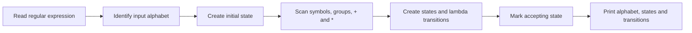

# Regular Expression → Nondeterministic Finite Automaton

**Automata theory · Python · NFA transitions**

A compact course exercise that reads a regular-expression string and constructs a nondeterministic finite automaton using named states (`q0`, `q1`, …) and transitions, including lambda (`λ`) transitions.

## Conversion workflow



## Run

```bash
git clone https://github.com/Parand1khalili/NFA.git
cd NFA
python main1.py
```

The program asks for `enter RE:` and prints the alphabet, state set, initial state, accepting states, and transition triples in the format:

```text
from_state  input_symbol  to_state
```

This describes the **output format**, not a newly executed example. See [`main1.py`](./main1.py) for parsing rules.

## Implementation notes

- State transitions are stored in nested dictionaries of sets, allowing more than one destination for the same symbol.
- The converter implements selected operators including `+`, `*`, and parenthesized groups.
- Input syntax is handled by a custom character-scanning algorithm; it is **not a validated general-purpose regex parser**. Check nesting, malformed expressions, operator precedence, and equivalence against independent cases before using its output for language recognition.

*Related project: [CFG → PDA](https://github.com/Parand1khalili/PDA).*
